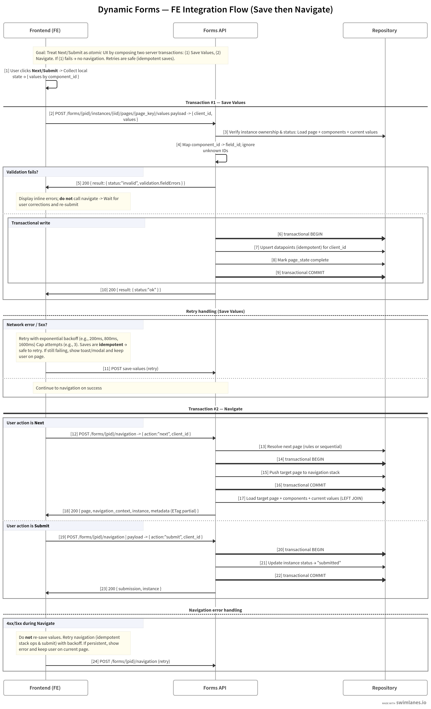

# Dynamic Forms — Full Flow Integration (Save -> Navigate)

This diagram shows how front‑end clients compose **two separate endpoints** into a single, atomic user action when the user clicks **Next** or **Submit**:

1. **Save Values** — persist the page data. Navigate **only** if the save returns `status: "ok"`.
2. **Navigate** — move to the next page or finalize on submit.

**v1.0 (staging) notes**
- Backend validation/sanitization is not fully enforced yet (planned before prod).
- Saves are **idempotent**; clients can safely retry on network/5xx errors.
- ETag is emitted for caching only.
- Dependency metadata is provided (`depends_on_component_id`, `rules`), but FE computes visibility.

> Image path: `./assets/full_flow_v1.png` (from this document's location use `../assets/full_flow_v1.png`).